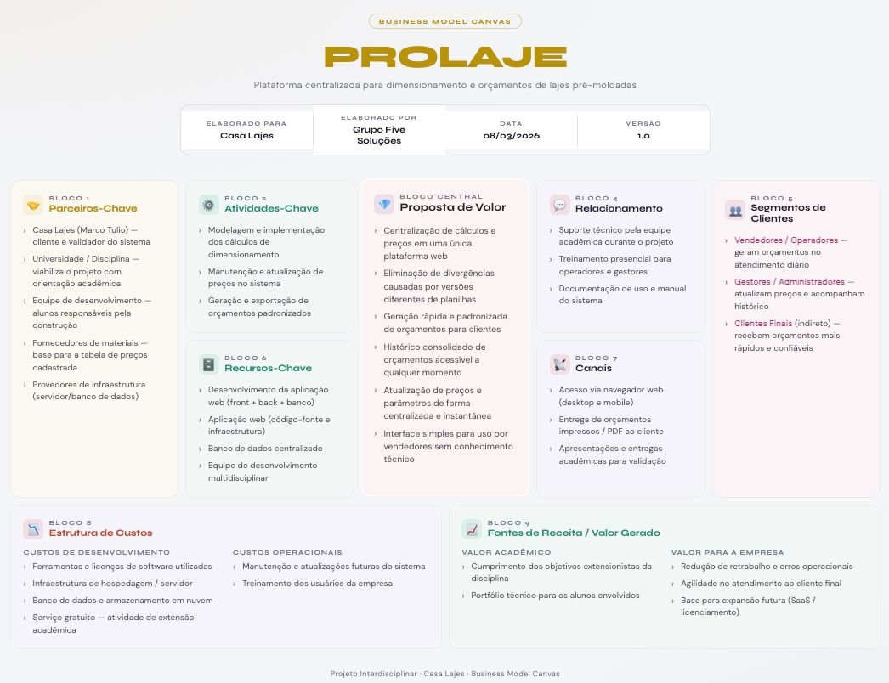

# Especificação do projeto

Pré-requisitos: <a href="01-Contexto.md"> Documentação de contexto</a>

Esta seção tem como finalidade apresentar o problema identificado e a solução proposta a partir da perspectiva dos usuários e do contexto da empresa parceira. O objetivo é organizar e descrever os principais elementos que orientam o desenvolvimento do sistema, considerando as necessidades operacionais relacionadas ao processo de orçamento de lajes pré-moldadas.

Para isso, são reunidas nesta etapa informações que ajudam a definir o funcionamento esperado da aplicação, incluindo **personas**, **histórias de usuários**, **requisitos funcionais**, **requisitos não funcionais** e as **restrições do projeto**. Esses elementos permitem estruturar melhor o escopo da solução e alinhar o entendimento entre os membros da equipe e os envolvidos no projeto.

As definições apresentadas foram construídas a partir do levantamento inicial das informações fornecidas pela empresa parceira e da análise da planilha atualmente utilizada no processo de cálculo e geração de orçamentos.

## Modelo de negócio (*Business Model Canvas*)

O Business Model Canvas (BMC) é uma ferramenta de planejamento estratégico que descreve, de forma visual e integrada, como uma organização cria, entrega e captura valor.
No contexto do PROLAJE, o BMC foi utilizado para estruturar e comunicar a proposta do sistema web desenvolvido para a empresa Casa Lajes. A ferramenta permitiu à equipe mapear os principais elementos do projeto desde os parceiros e recursos envolvidos até a proposta de valor entregue e os segmentos de usuários atendidos servindo como base para decisões técnicas, de design e de priorização de funcionalidades.
A construção do canvas partiu do problema real identificado na empresa: o uso de planilhas Excel descentralizadas, com versões divergentes, falhas frequentes e ausência de histórico consolidado de orçamentos. A partir disso, o grupo definiu como proposta central a criação de uma plataforma web que centralize cálculos, padronize orçamentos e ofereça uma base de dados única e confiável para vendedores, operadores e gestores da Casa Lajes. 

## Personas

Com base no contexto levantado com a empresa parceira **Casa Lajes**, foram identificadas as seguintes personas para a solução proposta.

### Persona 1 - Vendedor/Operador

**Nome fictício:** Carlos  
**Idade:** 31 anos  
**Perfil:** atua diretamente no atendimento ao cliente e na elaboração de orçamentos.  
**Conhecimento em tecnologia:** básico a intermediário; utiliza computador no dia a dia, mas não possui conhecimento técnico em sistemas.  
**Necessidades:** agilidade no atendimento, facilidade de uso e confiança nos cálculos gerados.  
**Dores atuais:** depende de planilhas que travam, possuem fórmulas complexas e podem apresentar resultados inconsistentes.  
**Objetivo principal:** gerar orçamentos de forma rápida, padronizada e sem risco de erro.

### Persona 2 - Gestor/Responsável Operacional

**Nome fictício:** Marco  
**Idade:** 45 anos  
**Perfil:** acompanha o funcionamento geral da operação e é responsável por definir preços, parâmetros e regras de cálculo.  
**Conhecimento em tecnologia:** intermediário; utiliza ferramentas digitais no controle do negócio, mas não atua como técnico de TI.  
**Necessidades:** manter preços e parâmetros atualizados, reduzir falhas no processo e garantir padronização nas informações.  
**Dores atuais:** dificuldade para manter uma única versão confiável da planilha e controlar mudanças nos dados utilizados pelos funcionários.  
**Objetivo principal:** ter mais controle sobre o processo de orçamento e garantir que todos usem as mesmas regras de cálculo.

### Persona 3 - Cliente Final

**Nome fictício:** João  
**Idade:** 39 anos  
**Perfil:** cliente que procura orçamento para lajes pré-moldadas em uma obra residencial ou comercial.  
**Conhecimento em tecnologia:** variável; não utiliza o sistema diretamente.  
**Necessidades:** receber um orçamento claro, rápido e confiável.  
**Dores atuais:** demora no atendimento e possibilidade de informações divergentes.  
**Objetivo principal:** entender o valor do serviço e tomar uma decisão com base em um orçamento profissional.

## Histórias de usuários

Com base na análise das personas, foram identificadas as seguintes histórias de usuários para a solução.

### Contexto 1 - Configuração e manutenção de parâmetros

|EU COMO... `PERSONA`| QUERO/PRECISO ... `FUNCIONALIDADE` |PARA ... `MOTIVO/VALOR` |
|--------------------|------------------------------------|------------------------|
|Gestor/Responsável Operacional| atualizar preços de materiais e parâmetros de cálculo | manter os orçamentos sempre alinhados com a realidade da empresa |
|Gestor/Responsável Operacional| alterar regras e parâmetros do cálculo sem depender de mudanças diretas no código | facilitar ajustes operacionais e reduzir dependência técnica |

### Contexto 2 - Geração de orçamentos

|EU COMO... `PERSONA`| QUERO/PRECISO ... `FUNCIONALIDADE` |PARA ... `MOTIVO/VALOR` |
|--------------------|------------------------------------|------------------------|
|Vendedor/Operador| cadastrar os dados do cliente | identificar corretamente o orçamento realizado |
|Vendedor/Operador| informar uma ou mais lajes com suas dimensões | calcular os materiais necessários para cada orçamento |
|Vendedor/Operador| obter automaticamente os quantitativos de materiais | evitar erros manuais e ganhar agilidade no atendimento |
|Vendedor/Operador| visualizar o valor total do orçamento já calculado | apresentar rapidamente o resultado ao cliente |
|Vendedor/Operador| gerar um orçamento em PDF | entregar um documento padronizado e profissional ao cliente |

### Contexto 3 - Consulta e apoio à operação

|EU COMO... `PERSONA`| QUERO/PRECISO ... `FUNCIONALIDADE` |PARA ... `MOTIVO/VALOR` |
|--------------------|------------------------------------|------------------------|
|Vendedor/Operador| consultar orçamentos já gerados | recuperar informações sem precisar refazer todo o processo |
|Gestor/Responsável Operacional| acessar os registros de orçamentos emitidos | acompanhar a operação e ter mais controle sobre os atendimentos |
|Gestor/Responsável Operacional| emitir relação de produção ou materiais calculados | apoiar a organização da produção e conferência dos itens necessários |

### Contexto 4 - Valor percebido pelo cliente

|EU COMO... `PERSONA`| QUERO/PRECISO ... `FUNCIONALIDADE` |PARA ... `MOTIVO/VALOR` |
|--------------------|------------------------------------|------------------------|
|Cliente Final| receber um orçamento claro e padronizado | entender a proposta com mais segurança |
|Cliente Final| receber o orçamento com rapidez | tomar decisão sem demora no atendimento |

 ## Requisitos

Com base no contexto levantado com a empresa parceira **Casa Lajes** e na análise da planilha de referência atualmente utilizada no processo de orçamento, foram definidos os requisitos funcionais e não funcionais da solução proposta.

Para determinar a prioridade dos requisitos, foi utilizada uma adaptação da técnica **MoSCoW**, convertida para os níveis **ALTA**, **MÉDIA** e **BAIXA**. A classificação foi aplicada da seguinte forma:

- **ALTA**: requisitos essenciais para que o sistema cumpra seu objetivo principal, que é apoiar o cálculo e a geração de orçamentos de lajes pré-moldadas.
- **MÉDIA**: requisitos importantes para complementar a operação, mas que não impedem o funcionamento principal da solução.
- **BAIXA**: requisitos complementares ou dependentes de decisões futuras, podendo ser implementados em versões posteriores.

## Requisitos funcionais

### Definição de pronto dos requisitos

Um requisito funcional será considerado pronto quando:
- estiver implementado conforme a descrição;
- funcionar sem erros nos cenários principais;
- processar corretamente os dados informados pelo usuário;
- apresentar o resultado esperado na interface;
- estiver integrado ao fluxo principal do sistema.

| ID | Descrição do Requisito | Prioridade |
|---|---|---|
| RF-001 | Permitir o cadastro e a atualização centralizada de preços, parâmetros de cálculo e materiais padrão utilizados no orçamento | ALTA |
| RF-002 | Permitir a importação de uma lista prévia de materiais em aba específica do sistema | MÉDIA |
| RF-003 | Permitir o cadastro dos dados do cliente para geração do orçamento | ALTA |
| RF-004 | Permitir o cadastro de uma ou mais lajes/ambientes no mesmo orçamento, informando suas dimensões | ALTA |
| RF-005 | Permitir o cálculo de lajes regulares e irregulares com base nas regras validadas com a empresa parceira | ALTA |
| RF-006 | Calcular automaticamente os quantitativos de materiais da laje, incluindo vigotas, enchimento e demais itens aplicáveis | ALTA |
| RF-007 | Calcular automaticamente a quantidade de malha da laje com base na área calculada | ALTA |
| RF-008 | Calcular automaticamente o valor total do orçamento, considerando materiais, malha, reforços e frete | ALTA |
| RF-009 | Gerar o orçamento de forma estruturada para visualização pelo usuário | ALTA |
| RF-010 | Permitir a emissão do orçamento em PDF | ALTA |
| RF-011 | Permitir o registro dos orçamentos gerados para consulta futura | MÉDIA |
| RF-012 | Permitir a consulta e filtragem do histórico de orçamentos | BAIXA |
| RF-013 | Permitir a emissão de relatório ou relação de produção das vigas e materiais calculados | BAIXA |

## Requisitos não funcionais

### Definição de pronto dos requisitos

Um requisito não funcional será considerado pronto quando:
- a característica de qualidade estiver aplicada na solução;
- puder ser verificada em uso, teste ou validação da equipe;
- atender ao nível mínimo esperado para o sistema;
- estiver compatível com o fluxo ao qual se relaciona.

| ID | Descrição do Requisito | Prioridade |
|---|---|---|
| RNF-001 | O sistema deve ser responsivo para rodar em dispositivos móveis e computadores | ALTA |
| RNF-002 | O sistema deve apresentar o mesmo resultado de cálculo independentemente do dispositivo utilizado | ALTA |
| RNF-003 | As informações do sistema devem permanecer centralizadas, evitando divergência entre versões utilizadas pelos usuários | ALTA |
| RNF-004 | O cálculo e a geração do orçamento devem ser processados em no máximo 5 segundos em operações comuns | MÉDIA |
| RNF-005 | A lógica de cálculo deve estar centralizada na aplicação, sem depender de planilhas locais | ALTA |
| RNF-006 | O sistema deve seguir as regras de cálculo validadas com a empresa parceira para lajes irregulares, malha e quantitativos | ALTA |
| RNF-007 | O sistema deve possuir interface simples e de fácil utilização para usuários com conhecimento técnico básico | MÉDIA |
| RNF-008 | O sistema deve permitir atualização de parâmetros e regras configuráveis sem necessidade de alteração direta no código-fonte, sempre que aplicável | MÉDIA |
| RNF-009 | O documento PDF gerado deve possuir layout legível e padronizado para entrega ao cliente | BAIXA |
| RNF-010 | Caso os orçamentos sejam armazenados, os dados devem ser mantidos de forma íntegra e consistente | BAIXA |

## Restrições

Enumere as restrições à sua solução. Lembre-se de que as restrições geralmente limitam a solução candidata.

O projeto está restrito aos itens apresentados na tabela a seguir.

| ID  | Restrição                                                                                                                                                                    |
| --- | ---------------------------------------------------------------------------------------------------------------------------------------------------------------------------- |
| 001 | O projeto deverá ser desenvolvido e entregue dentro do prazo definido pela disciplina durante o semestre letivo.                                                             |
| 002 | O sistema deve respeitar a lógica de cálculo atualmente utilizada na planilha da empresa parceira, garantindo que os resultados permaneçam compatíveis com o processo atual. |
| 003 | O desenvolvimento será realizado pelos alunos da disciplina, podendo haver limitação de tempo e recursos técnicos disponíveis para implementação.                            |
| 004 | A solução deverá ser acessível por meio de navegador web, sem exigir instalação de softwares específicos nos computadores da empresa.                                        |                                            
| 005 | A definição final sobre armazenamento persistente de dados (como banco de dados para histórico de orçamentos) poderá sofrer ajustes conforme a evolução do projeto.          |
| 006 | A solução deverá manter uma interface simples e de fácil utilização, considerando que os usuários possuem conhecimento técnico limitado em sistemas.                         |
| 007 | O sistema deverá ser desenvolvido considerando as informações e documentos fornecidos pela empresa parceira como base para o funcionamento do cálculo.                       |

## Tabela de rastreabilidade

A tabela de rastreabilidade relaciona os requisitos funcionais e não funcionais do sistema com as histórias de usuário, os processos envolvidos e as entidades principais da solução, garantindo alinhamento entre as necessidades da empresa e a estrutura proposta para o sistema.

| Requisito | História de usuário / objetivo relacionado | Processo relacionado | Entidades relacionadas |
|---|---|---|---|
| RF-001 | Cadastrar e atualizar preços, parâmetros e materiais padrão | Configuração e manutenção de parâmetros | PARAMETRO, MATERIAL |
| RF-002 | Importar lista prévia de materiais | Configuração e manutenção de parâmetros | MATERIAL |
| RF-003 | Cadastrar os dados do cliente | Geração de orçamentos | CLIENTE |
| RF-004 | Informar uma ou mais lajes com dimensões | Geração de orçamentos | ORCAMENTO, ITEM_ORCAMENTO |
| RF-005 | Calcular lajes regulares e irregulares | Geração de orçamentos | ITEM_ORCAMENTO, PARAMETRO |
| RF-006 | Calcular quantitativos de materiais da laje | Geração de orçamentos | ITEM_ORCAMENTO, MATERIAL |
| RF-007 | Calcular quantidade de malha da laje | Geração de orçamentos | ITEM_ORCAMENTO, MATERIAL |
| RF-008 | Calcular valor total do orçamento | Geração de orçamentos | ORCAMENTO |
| RF-009 | Visualizar orçamento estruturado | Geração de orçamentos | ORCAMENTO |
| RF-010 | Gerar orçamento em PDF | Geração de orçamentos | ORCAMENTO |
| RF-011 | Registrar orçamentos gerados | Consulta e apoio à operação | ORCAMENTO, CLIENTE |
| RF-012 | Consultar e filtrar histórico de orçamentos | Consulta e apoio à operação | ORCAMENTO |
| RF-013 | Emitir relação de produção e materiais calculados | Consulta e apoio à operação | ITEM_ORCAMENTO, MATERIAL |
| RNF-001 | Garantir responsividade em dispositivos móveis e computadores | Interface e acesso ao sistema | INTERFACE |
| RNF-002 | Garantir consistência dos resultados em diferentes dispositivos | Geração de orçamentos | PARAMETRO, ITEM_ORCAMENTO |
| RNF-003 | Manter informações centralizadas e padronizadas | Configuração e manutenção de parâmetros | PARAMETRO, ORCAMENTO, MATERIAL |
| RNF-005 | Centralizar a lógica de cálculo na aplicação | Geração de orçamentos | PARAMETRO, ITEM_ORCAMENTO |
| RNF-006 | Seguir regras validadas pela empresa para cálculos de lajes e quantitativos | Geração de orçamentos | PARAMETRO, ITEM_ORCAMENTO, MATERIAL |
