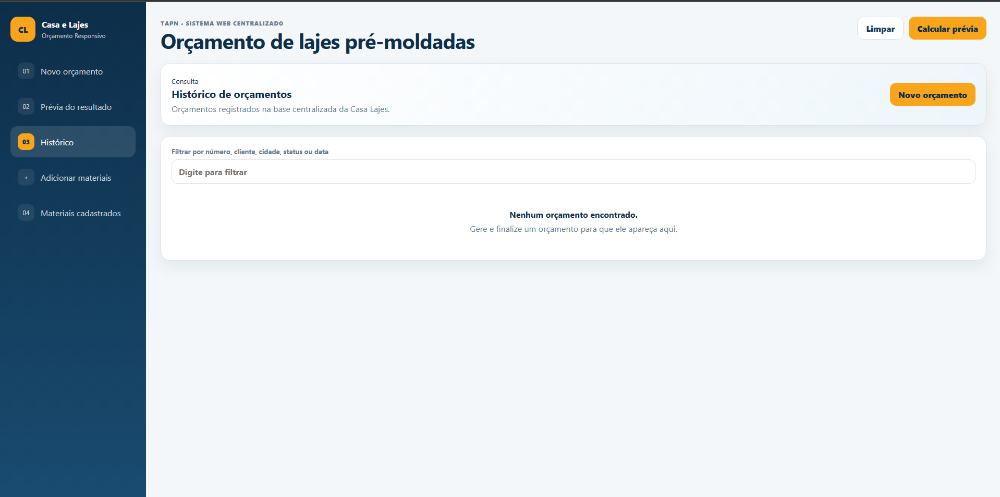

# Template padrão da aplicação

<span style="color:red">Pré-requisitos: <a href="02-Especificacao.md"> Especificação do projeto</a></span>, <a href="03-Metodologia.md"> Metodologia</a>, <a href="05-Projeto-interface.md"> Projeto de interface</a>

Este documento define o **template padrão da aplicação PROLAJES**, incluindo identidade visual, estrutura de layout, orientações de responsividade, iconografia e manual de uso da marca. O objetivo é garantir que todas as telas mantenham unidade visual, facilidade de uso e consistência com a proposta do sistema: centralizar o dimensionamento de materiais e a geração de orçamentos de lajes pré-moldadas.

A identidade foi construída a partir da referência visual da Casa Lajes e da interface atual do sistema, preservando a relação com construção civil, lajes pré-moldadas, orçamento técnico e atendimento rápido ao cliente.

---

## 1. Identidade visual da aplicação

A marca visual do PROLAJES utiliza uma linguagem **limpa, técnica e profissional**, adequada para uma aplicação web de orçamento de lajes pré-moldadas. A proposta visual combina:

- **azul-marinho**, transmitindo segurança, organização e confiabilidade;
- **amarelo/dourado**, remetendo a ação, destaque, energia e elementos de construção;
- **fundos claros**, para facilitar leitura em uso prolongado;
- **cards arredondados**, que organizam informações técnicas sem tornar a interface pesada;
- **botões bem contrastados**, priorizando ações importantes como calcular, salvar, exportar e gerar PDF.

### Logotipo principal

O logotipo adotado utiliza o nome **Prolajes** com um símbolo minimalista inspirado em casa, estrutura de obra e placas de laje pré-moldada. O ícone representa a ligação entre o orçamento técnico e a construção final do imóvel.

<p align="center">
  
</p>

### Significado do logotipo

O símbolo combina três ideias centrais do projeto:

| Elemento | Significado |
|---|---|
| Telhado/casa | Representa o resultado final desejado pelo cliente: a obra construída com segurança. |
| Painéis de laje | Representam as lajes pré-moldadas e o dimensionamento técnico realizado pelo sistema. |
| Azul-marinho | Reforça confiança, padronização e controle dos dados. |
| Amarelo/dourado | Destaca as ações principais e transmite agilidade no atendimento. |
| Tipografia simples | Facilita leitura em tela, PDF, relatórios e navegação no sistema. |

---

## 2. Paleta de cores

A paleta foi definida para manter coerência com a interface já implementada, priorizando contraste, legibilidade e identificação rápida das ações principais.

| Uso | Cor | Hexadecimal | Aplicação recomendada |
|---|---:|---:|---|
| Azul principal |  | `#0D3B59` | Menu lateral, títulos principais, textos de destaque e marca. |
| Azul escuro |  | `#082A43` | Títulos, cabeçalhos e contraste de textos. |
| Azul médio |  | `#194D6E` | Estados ativos, indicadores, chips e apoio visual. |
| Amarelo principal |  | `#FFB11A` | Botões primários, item ativo do menu e destaques. |
| Amarelo escuro |  | `#E79A00` | Hover de botões principais e reforço de contraste. |
| Fundo da aplicação |  | `#F3F7FA` | Área geral de conteúdo. |
| Fundo dos cards |  | `#FFFFFF` | Formulários, tabelas, cards e modais. |
| Borda suave |  | `#D8E6F0` | Contornos de inputs, cards e divisórias. |
| Texto secundário |  | `#617D96` | Descrições, subtítulos e mensagens auxiliares. |
| Erro/alerta |  | `#C53030` | Validações, falhas de cadastro e avisos críticos. |

### Variáveis CSS recomendadas

```css
:root {
  --color-primary: #0d3b59;
  --color-primary-dark: #082a43;
  --color-primary-soft: #194d6e;
  --color-accent: #ffb11a;
  --color-accent-dark: #e79a00;
  --color-background: #f3f7fa;
  --color-surface: #ffffff;
  --color-border: #d8e6f0;
  --color-text: #082a43;
  --color-muted: #617d96;
  --color-danger: #c53030;
}
```

---

## 3. Tipografia

A tipografia deve ser simples, moderna e legível. Como o sistema será utilizado durante atendimento ao cliente, o texto precisa ser claro mesmo em telas menores ou computadores com baixa resolução.

| Elemento | Fonte recomendada | Peso | Uso |
|---|---|---:|---|
| Títulos principais | Inter, Poppins ou system-ui | 700 / 800 | Nome da tela, título de orçamento e cabeçalhos. |
| Subtítulos | Inter, Poppins ou system-ui | 600 | Seções como Dados do Cliente, Dimensões e Histórico. |
| Texto comum | Inter, Arial ou system-ui | 400 / 500 | Labels, descrições e informações do orçamento. |
| Botões | Inter, Poppins ou system-ui | 700 | Ações principais e secundárias. |
| Números e valores | Inter ou system-ui | 600 / 700 | Totais, quantidades, metragem e valores financeiros. |

### Escala recomendada

| Uso | Tamanho desktop | Tamanho mobile |
|---|---:|---:|
| Título da página | 34px a 40px | 26px a 30px |
| Título de seção | 18px a 22px | 17px a 20px |
| Texto de formulário | 14px a 16px | 14px a 16px |
| Texto auxiliar | 12px a 14px | 12px a 14px |
| Botões | 14px a 16px | 14px a 16px |

---

## 4. Layout padrão das telas

O template base da aplicação é composto por **menu lateral fixo** e **área de conteúdo principal**. Essa organização facilita a navegação entre as etapas do orçamento, mantendo o fluxo de trabalho linear e previsível.

### Estrutura geral

```text
+---------------------------------------------------------------+
| Sidebar fixa       | Cabeçalho da tela + ações principais       |
|                    |--------------------------------------------|
| Logo / nome        | Cards, formulários, tabelas e modais        |
| Navegação          | Conteúdo contextual da tela selecionada     |
|                    |                                            |
+---------------------------------------------------------------+
```

### Sidebar

A barra lateral deve permanecer visualmente consistente em todas as telas.

**Elementos obrigatórios:**

- bloco de marca com ícone ou logotipo reduzido;
- nome do sistema ou empresa;
- subtítulo curto, como “Orçamento Responsivo”;
- lista de navegação com numeração ou ícone;
- indicação clara da tela ativa;
- contraste alto entre fundo azul e texto claro.

**Itens principais de navegação:**

1. Novo orçamento
2. Prévia do resultado
3. Histórico
4. Adicionar materiais
5. Materiais cadastrados

### Área principal

A área principal deve conter:

- etiqueta superior curta, como `TAPN • SISTEMA WEB CENTRALIZADO`;
- título grande da tela;
- botões de ação no canto superior direito;
- cards brancos com bordas suaves;
- espaçamento generoso entre blocos;
- tabelas com rolagem horizontal quando necessário.

---

## 5. Componentes visuais padrão

### Botões

| Tipo | Aparência | Uso |
|---|---|---|
| Primário | Fundo amarelo, texto azul escuro, bordas arredondadas | Calcular prévia, salvar orçamento, gerar PDF, exportar Excel. |
| Secundário | Fundo branco, borda azul clara, texto azul escuro | Limpar, cancelar, voltar, fechar modal. |
| Perigo | Fundo vermelho ou borda vermelha | Excluir material, excluir orçamento. |

Os botões principais devem ter destaque visual forte, pois conduzem a geração do orçamento e exportações.

### Cards

Os cards agrupam informações do fluxo de orçamento. Devem usar fundo branco, borda suave e sombra discreta.

**Uso recomendado:**

- dados do cliente;
- dimensões da laje;
- parâmetros de cálculo;
- resumo de materiais;
- histórico de orçamentos;
- lista de materiais cadastrados.

### Formulários

Os campos de formulário devem ter labels visíveis, placeholder objetivo e validação clara. A ordem dos campos deve seguir a lógica do atendimento: primeiro cliente, depois obra, depois lajes e parâmetros.

### Tabelas

As tabelas devem priorizar leitura rápida de números e itens técnicos. Em telas pequenas, devem permitir rolagem horizontal sem quebrar o layout.

---

## 6. Iconografia

A iconografia deve ser simples e funcional. Os ícones não devem competir com os dados técnicos; devem apenas ajudar na identificação das ações.

| Contexto | Ícone sugerido | Significado |
|---|---|---|
| Novo orçamento | Documento ou sinal de adição | Criação de orçamento. |
| Prévia | Olho ou tabela | Conferência antes de salvar/exportar. |
| Histórico | Relógio ou arquivo | Consulta de orçamentos anteriores. |
| Materiais | Caixa, lista ou bloco | Cadastro e consulta de materiais. |
| PDF | Arquivo | Geração de demonstrativo. |
| Excel | Planilha | Exportação da lista de materiais. |
| Excluir | Lixeira | Remoção de item ou orçamento. |

Os ícones devem seguir o mesmo estilo: linhas simples, cantos arredondados e preenchimento mínimo.

---

## 7. Responsividade

A aplicação deve funcionar em computadores, tablets e celulares. O template deve se adaptar sem perder o fluxo principal de uso.

### Desktop

- Sidebar fixa à esquerda.
- Conteúdo em largura total à direita.
- Cards em grid de duas ou mais colunas quando houver espaço.
- Tabelas com colunas completas.

### Tablet

- Sidebar pode ser reduzida ou transformada em navegação compacta.
- Cards devem se reorganizar em uma ou duas colunas.
- Botões de ação podem quebrar linha, mantendo espaçamento.

### Mobile

- Sidebar deve virar menu compacto, superior ou recolhível.
- Cards devem ocupar uma coluna.
- Tabelas devem usar `overflow-x: auto`.
- Modais devem ocupar quase toda a largura da tela.
- Botões principais devem ter área de toque confortável.

### Breakpoints recomendados

```css
/* Desktop padrão */
@media (min-width: 1024px) { }

/* Tablet */
@media (max-width: 1023px) { }

/* Celular */
@media (max-width: 640px) { }
```

---

## 8. Uso correto do logotipo

### Versões permitidas

| Versão | Uso recomendado |
|---|---|
| Logotipo completo | Documentação, tela inicial, PDF e apresentações. |
| Ícone isolado | Sidebar reduzida, favicon, avatar do sistema e cards pequenos. |
| Monocromático azul | Impressões simples ou uso em fundo claro sem necessidade de destaque. |
| Versão negativa | Uso sobre fundo azul-marinho. |

### Regras de aplicação

- Manter área de respiro ao redor do logotipo equivalente a pelo menos a altura da letra “P”.
- Não distorcer, achatar ou inclinar o logotipo.
- Não aplicar sombras fortes, contornos extras ou gradientes pesados.
- Não alterar as cores oficiais sem necessidade técnica.
- Não posicionar o logotipo sobre fundos com baixa leitura.
- Em tamanhos muito pequenos, usar apenas o ícone simplificado.

### Tamanho mínimo recomendado

| Aplicação | Largura mínima |
|---|---:|
| Logotipo completo em tela | 180px |
| Logotipo completo em PDF | 45mm |
| Ícone isolado | 32px |
| Favicon | 16px ou 32px |

---

## 9. Tela de exemplo do template

A tela abaixo demonstra a aplicação do template visual no sistema. Ela usa sidebar azul, destaque amarelo para ação ativa, área principal clara, cards com bordas suaves e campo de busca em formato arredondado.

<p align="center">
  
</p>

### Análise da tela

| Elemento | Aplicação no template |
|---|---|
| Menu lateral | Mantém navegação visível e identifica a etapa atual do fluxo. |
| Item ativo | Usa destaque amarelo e fundo azul médio para indicar localização do usuário. |
| Título principal | Usa alto contraste e hierarquia clara para indicar o objetivo da tela. |
| Card de contexto | Apresenta a função da tela, como consulta ou geração de orçamento. |
| Botão primário | Usa amarelo para ação principal, como “Novo orçamento” ou “Calcular prévia”. |
| Campo de busca | Permite filtragem rápida sem poluir a interface. |
| Espaçamento | Mantém a leitura confortável e evita sobrecarga visual. |

---

## 10. Diretrizes para novas telas

Toda nova tela do sistema deve seguir as seguintes regras:

1. Usar o mesmo menu lateral e manter o item ativo corretamente marcado.
2. Utilizar título claro e objetivo no topo da área principal.
3. Posicionar ações principais no canto superior direito sempre que possível.
4. Organizar formulários e resultados em cards brancos.
5. Manter botões primários em amarelo e secundários em branco.
6. Evitar excesso de cores fora da paleta oficial.
7. Usar tabelas responsivas para listas de orçamentos, materiais e produção.
8. Garantir leitura adequada em desktop, tablet e celular.
9. Preservar a linguagem simples, voltada para vendedores e gestores com conhecimento técnico básico.

---

## 11. Relação com a proposta do sistema

O template visual reforça os objetivos do PROLAJES ao transmitir:

- **agilidade**, por meio de navegação simples e ações bem destacadas;
- **confiabilidade**, por meio de cores sóbrias, organização visual e padronização;
- **clareza**, por meio de tipografia legível e hierarquia de informações;
- **profissionalismo**, por meio de PDF, Excel, histórico e orçamento apresentados de forma padronizada;
- **centralização**, por meio de telas consistentes que substituem a experiência fragmentada de planilhas locais.

Assim, o template não atua apenas como elemento visual, mas como parte da solução proposta para tornar o processo de orçamento mais organizado, seguro e fácil de utilizar.

---

## 12. Resumo do padrão visual

| Categoria | Padrão definido |
|---|---|
| Nome da aplicação | PROLAJES |
| Estilo visual | Minimalista, técnico e profissional |
| Cores principais | Azul-marinho e amarelo/dourado |
| Layout | Sidebar fixa + área principal em cards |
| Tipografia | Sans-serif moderna, com alta legibilidade |
| Botões principais | Amarelo com texto azul escuro |
| Fundos | Claro na área principal e azul na navegação |
| Responsividade | Desktop, tablet e mobile |
| Imagens obrigatórias | Logotipo PROLAJES e uma tela exemplo do sistema |
