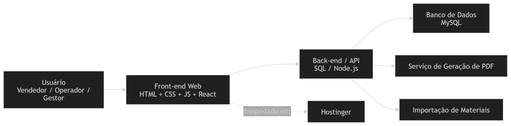
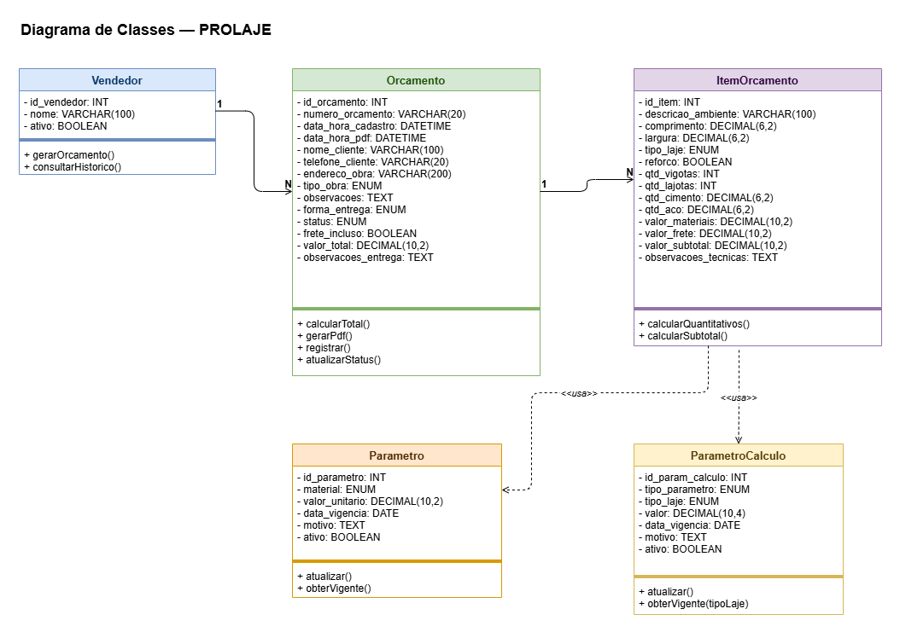
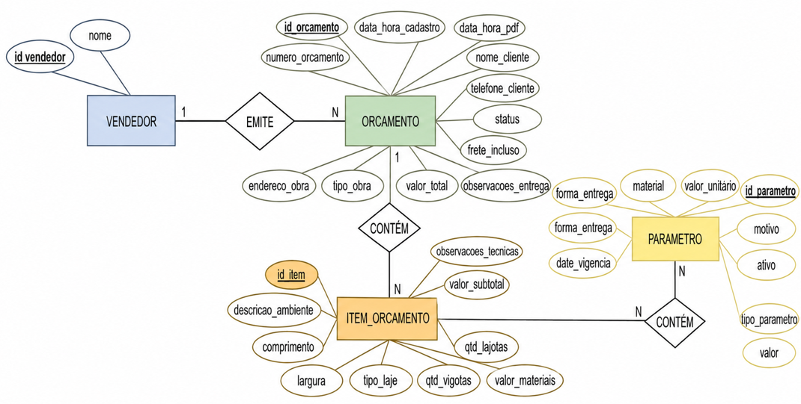
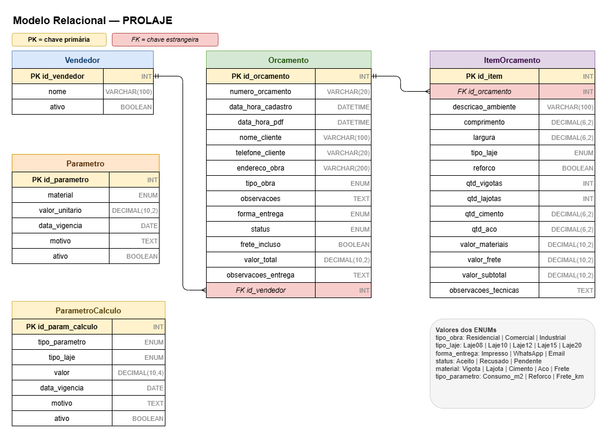

# Arquitetura da solução

<span style="color:red">Pré-requisitos: <a href="05-Projeto-interface.md"> Projeto de interface</a></span>

A solução proposta para o PROLAJE será estruturada como uma **aplicação web em camadas**, organizada em três componentes principais: **front-end**, **back-end** e **banco de dados**. O front-end será responsável pela interface utilizada no navegador para cadastro dos dados do cliente, inserção das dimensões da laje, visualização do orçamento e emissão do PDF. O back-end concentrará a lógica de negócio da aplicação, incluindo os cálculos das lajes, processamento dos quantitativos, aplicação das regras de orçamento e integração com a base de dados. O banco de dados será responsável pelo armazenamento centralizado das informações do sistema, como parâmetros, materiais, clientes e orçamentos.

Essa estrutura foi definida para garantir maior padronização dos cálculos, evitar dependência de planilhas locais e permitir evolução futura da solução. O diagrama a seguir apresenta a visão geral da arquitetura, mostrando como os componentes da aplicação se comunicam e como a solução poderá ser hospedada em ambiente web para acesso pelos usuários da empresa.



## Diagrama de classes
 
O diagrama de classes do PROLAJE representa a estrutura orientada a objetos da aplicação, detalhando as principais classes, seus atributos, métodos e relacionamentos. As classes foram definidas com base nos processos TO BE mapeados e nos requisitos funcionais levantados junto à empresa parceira Casa Lajes.
 
### Classes principais
 
**Vendedor**
Representa o usuário operacional do sistema, responsável pelo atendimento ao cliente e pela geração dos orçamentos.
- Atributos: `idVendedor`, `nome`, `ativo`
- Métodos: `gerarOrcamento()`, `consultarHistorico()`
**Orcamento**
Classe central da aplicação. Concentra as informações do cliente, os dados da obra e o resultado financeiro do orçamento gerado.
- Atributos: `idOrcamento`, `numeroOrcamento`, `dataHoraCadastro`, `dataHoraPdf`, `nomeCliente`, `telefoneCliente`, `enderecoObra`, `tipoObra`, `observacoes`, `formaEntrega`, `status`, `freteIncluso`, `valorTotal`, `observacoesEntrega`
- Métodos: `calcularTotal()`, `gerarPdf()`, `registrar()`, `atualizarStatus()`
**ItemOrcamento**
Representa cada laje ou ambiente informado dentro de um orçamento. Armazena as dimensões e os quantitativos calculados pelo sistema.
- Atributos: `idItem`, `descricaoAmbiente`, `comprimento`, `largura`, `tipoLaje`, `reforco`, `qtdVigotas`, `qtdLajotas`, `qtdCimento`, `qtdAco`, `valorMateriais`, `valorFrete`, `valorSubtotal`, `observacoesTecnicas`
- Métodos: `calcularQuantitativos()`, `calcularSubtotal()`
**Parametro**
Armazena os preços unitários dos materiais utilizados nos cálculos. Gerenciada pelo gestor da empresa.
- Atributos: `idParametro`, `material`, `valorUnitario`, `dataVigencia`, `motivo`, `ativo`
- Métodos: `atualizar()`, `obterVigente()`
**ParametroCalculo**
Armazena as regras técnicas de cálculo por tipo de laje, como consumo por m², fator de reforço e custo de frete por km.
- Atributos: `idParamCalculo`, `tipoParametro`, `tipoLaje`, `valor`, `dataVigencia`, `motivo`, `ativo`
- Métodos: `atualizar()`, `obterVigente(tipoLaje)`
### Relacionamentos
 
- `Vendedor` possui associação de composição com `Orcamento` (1 para N): um vendedor pode emitir múltiplos orçamentos.
- `Orcamento` possui associação de composição com `ItemOrcamento` (1 para N): um orçamento pode conter múltiplos itens/ambientes.
- `Orcamento` e `ItemOrcamento` utilizam os dados de `Parametro` e `ParametroCalculo` por meio de dependência via camada de serviço, sem acoplamento direto entre as classes.



 
---
 
## Modelo de dados
 
O desenvolvimento da solução proposta requer a existência de bases de dados que permitam realizar o cadastro de dados e os controles associados aos processos identificados, assim como suas recuperações.
 
### Modelo conceitual
 
O modelo conceitual do PROLAJE foi elaborado na notação de Peter Chen e representa as entidades do sistema, seus atributos e os relacionamentos entre elas, com as respectivas cardinalidades.
 
As entidades identificadas são:
 
- **VENDEDOR**: representa o usuário operacional que utiliza o sistema para gerar orçamentos. Atributos: `id_vendedor` (PK), `nome`, `ativo`.
- **ORCAMENTO**: entidade central que agrega os dados do cliente, da obra e o resultado do orçamento. Atributos: `id_orcamento` (PK), `numero_orcamento`, `data_hora_cadastro`, `data_hora_pdf`, `nome_cliente`, `telefone_cliente`, `endereco_obra`, `tipo_obra`, `observacoes`, `forma_entrega`, `status`, `frete_incluso`, `valor_total`, `observacoes_entrega`.
- **ITEM_ORCAMENTO**: representa cada laje ou ambiente cadastrado dentro de um orçamento. Atributos: `id_item` (PK), `descricao_ambiente`, `comprimento`, `largura`, `tipo_laje`, `reforco`, `qtd_vigotas`, `qtd_lajotas`, `qtd_cimento`, `qtd_aco`, `valor_materiais`, `valor_frete`, `valor_subtotal`, `observacoes_tecnicas`.
- **PARAMETRO**: armazena o histórico de preços unitários dos materiais. Atributos: `id_parametro` (PK), `material`, `valor_unitario`, `data_vigencia`, `motivo`, `ativo`.
- **PARAMETRO_CALCULO**: armazena as regras técnicas de cálculo por tipo de laje. Atributos: `id_param_calculo` (PK), `tipo_parametro`, `tipo_laje`, `valor`, `data_vigencia`, `motivo`, `ativo`.
**Relacionamentos:**
- `VENDEDOR` **emite** `ORCAMENTO` — cardinalidade 1:N (um vendedor emite um ou mais orçamentos; cada orçamento é emitido por um único vendedor).
- `ORCAMENTO` **contém** `ITEM_ORCAMENTO` — cardinalidade 1:N (um orçamento contém um ou mais itens; cada item pertence a um único orçamento).
- `PARAMETRO` e `PARAMETRO_CALCULO` são entidades de configuração consultadas pela lógica de negócio no momento do cálculo, sem relacionamento direto via chave estrangeira com as entidades transacionais.


 
 
---
 
### Modelo relacional
 
O modelo relacional do PROLAJE organiza as informações em cinco tabelas principais, com seus atributos, tipos de dados, chaves primárias e chaves estrangeiras definidas a partir do modelo conceitual.
 
| Tabela | Chave Primária | Chave Estrangeira |
|---|---|---|
| Vendedor | id_vendedor | — |
| Orcamento | id_orcamento | id_vendedor → Vendedor |
| ItemOrcamento | id_item | id_orcamento → Orcamento |
| Parametro | id_parametro | — |
| ParametroCalculo | id_param_calculo | — |
 
As tabelas `Parametro` e `ParametroCalculo` não possuem chave estrangeira explícita, pois funcionam como tabelas de configuração consultadas pela lógica de negócio via campo `ativo = TRUE`, garantindo que todos os cálculos utilizem sempre a tabela de preços e os parâmetros vigentes.
 
O modelo relacional completo foi elaborado na ferramenta draw.io e está disponível no repositório do projeto.


 
---
 
### Modelo físico
 
Script de criação das tabelas do banco de dados do PROLAJE, compatível com MySQL.
 
```sql
CREATE TABLE Vendedor (
    id_vendedor     INT             NOT NULL AUTO_INCREMENT,
    nome            VARCHAR(100)    NOT NULL,
    ativo           BOOLEAN         NOT NULL DEFAULT TRUE,
    PRIMARY KEY (id_vendedor)
);
 
CREATE TABLE Orcamento (
    id_orcamento        INT             NOT NULL AUTO_INCREMENT,
    numero_orcamento    VARCHAR(20)     NOT NULL,
    data_hora_cadastro  DATETIME        NOT NULL DEFAULT CURRENT_TIMESTAMP,
    data_hora_pdf       DATETIME,
    nome_cliente        VARCHAR(100)    NOT NULL,
    telefone_cliente    VARCHAR(20),
    endereco_obra       VARCHAR(200),
    tipo_obra           ENUM('Residencial','Comercial','Industrial') NOT NULL DEFAULT 'Residencial',
    observacoes         TEXT,
    forma_entrega       ENUM('Impresso','WhatsApp','Email'),
    status              ENUM('Aceito','Recusado','Pendente')         NOT NULL DEFAULT 'Pendente',
    frete_incluso       BOOLEAN         NOT NULL DEFAULT FALSE,
    valor_total         DECIMAL(10,2),
    observacoes_entrega TEXT,
    id_vendedor         INT             NOT NULL,
    PRIMARY KEY (id_orcamento),
    FOREIGN KEY (id_vendedor) REFERENCES Vendedor (id_vendedor)
);
 
CREATE TABLE ItemOrcamento (
    id_item                 INT             NOT NULL AUTO_INCREMENT,
    id_orcamento            INT             NOT NULL,
    descricao_ambiente      VARCHAR(100),
    comprimento             DECIMAL(6,2)    NOT NULL,
    largura                 DECIMAL(6,2)    NOT NULL,
    tipo_laje               ENUM('Laje08','Laje10','Laje12','Laje15','Laje20') NOT NULL,
    reforco                 BOOLEAN         NOT NULL DEFAULT FALSE,
    qtd_vigotas             INT,
    qtd_lajotas             INT,
    qtd_cimento             DECIMAL(6,2),
    qtd_aco                 DECIMAL(6,2),
    valor_materiais         DECIMAL(10,2),
    valor_frete             DECIMAL(10,2),
    valor_subtotal          DECIMAL(10,2),
    observacoes_tecnicas    TEXT,
    PRIMARY KEY (id_item),
    FOREIGN KEY (id_orcamento) REFERENCES Orcamento (id_orcamento) ON DELETE CASCADE
);
 
CREATE TABLE Parametro (
    id_parametro    INT             NOT NULL AUTO_INCREMENT,
    material        ENUM('Vigota','Lajota','Cimento','Aco','Frete') NOT NULL,
    valor_unitario  DECIMAL(10,2)   NOT NULL,
    data_vigencia   DATE            NOT NULL,
    motivo          TEXT,
    ativo           BOOLEAN         NOT NULL DEFAULT TRUE,
    PRIMARY KEY (id_parametro)
);
 
CREATE TABLE ParametroCalculo (
    id_param_calculo    INT             NOT NULL AUTO_INCREMENT,
    tipo_parametro      ENUM('Consumo_m2','Reforco','Frete_km') NOT NULL,
    tipo_laje           ENUM('Laje08','Laje10','Laje12','Laje15','Laje20') NOT NULL,
    valor               DECIMAL(10,4)   NOT NULL,
    data_vigencia       DATE            NOT NULL,
    motivo              TEXT,
    ativo               BOOLEAN         NOT NULL DEFAULT TRUE,
    PRIMARY KEY (id_param_calculo)
);
```
 
Este script deve ser incluído no arquivo `/src/db/prolaje.sql` no repositório do projeto.
 
---
 
## Tecnologias
 
As tecnologias utilizadas no desenvolvimento do PROLAJE foram escolhidas com base na simplicidade de implantação, familiaridade da equipe, disponibilidade de recursos gratuitos para projetos acadêmicos e compatibilidade com os requisitos não funcionais levantados — especialmente responsividade, centralização dos dados e acesso via navegador sem instalação de software.
 
| **Dimensão**       | **Tecnologia**          |
| ---                | ---                     |
| Front-end          | HTML + CSS + JavaScript + React |
| Back-end           | Node.js + Express       |
| SGBD               | MySQL                   |
| Deploy             | Vercel (front-end) + Hostinger do cliente (back-end e banco de dados) |
| Controle de versão | Git + GitHub            |
| Editor de código   | Visual Studio Code      |
| Modelagem          | draw.io                 |
| Geração de PDF     | Biblioteca jsPDF (JavaScript) |
 
### Interação entre as tecnologias
 
O fluxo de uso do sistema ocorre da seguinte forma:
 
1. O usuário (vendedor ou gestor) acessa o PROLAJE pelo navegador, por meio da interface React hospedada na Vercel.
2. Ao cadastrar os dados do cliente e as dimensões das lajes, o front-end envia uma requisição HTTP para a API Node.js/Express hospedada na Hostinger do cliente (VPS).
3. O back-end consulta as tabelas `Parametro` e `ParametroCalculo` no banco MySQL para obter os preços e regras vigentes, executa o cálculo dos quantitativos e retorna o resultado ao front-end.
4. O front-end exibe o orçamento calculado para revisão do vendedor e, após confirmação, aciona a geração do PDF via jsPDF no próprio navegador.
5. O back-end registra o orçamento gerado no banco de dados MySQL, tornando-o disponível no histórico centralizado para consulta do gestor.
---
 
## Hospedagem
 
A hospedagem do PROLAJE foi dividida entre duas plataformas gratuitas, adequadas ao porte e ao caráter acadêmico do projeto.
 
O **front-end** (aplicação React) será publicado na **Vercel**, que oferece integração direta com o repositório GitHub, permitindo que qualquer commit na branch `main` dispare automaticamente um novo deploy. O acesso se dará por uma URL pública gerada pela própria plataforma, sem necessidade de configuração de servidor.
 
O **back-end** (API Node.js/Express) e o **banco de dados MySQL** serão hospedados na **Hostinger do cliente**, serviço de nuvem que permite provisionar simultaneamente uma aplicação Node.js e uma instância MySQL no mesmo projeto, com variáveis de ambiente configuradas pelo painel da plataforma. A conexão entre o back-end e o banco é feita internamente na infraestrutura da Hostinger do cliente (VPS), sem exposição direta do banco à internet.
 
A comunicação entre front-end (Vercel) e back-end (VPS Hostinger) ocorre via HTTPS, com a URL da API configurada como variável de ambiente no projeto Vercel.
 
Esse modelo de hospedagem garante que todos os usuários da empresa acessem sempre a mesma versão do sistema e a mesma base de dados centralizada, eliminando o problema de versões divergentes identificado no processo AS IS.
 
---
 
## Qualidade de software
 
A qualidade de software no contexto do PROLAJE está diretamente relacionada à capacidade da solução atender às necessidades operacionais da empresa Casa Lajes de forma confiável, rápida, padronizada e simples de utilizar. Para apoiar o desenvolvimento da solução, foram consideradas subcaracterísticas de qualidade baseadas na norma ISO/IEC 25010, que define modelos de qualidade para sistemas e produtos de software.
 
As subcaracterísticas selecionadas foram definidas considerando os principais problemas identificados no processo atual da empresa, especialmente relacionados à inconsistência dos cálculos, dificuldade de manutenção das planilhas, demora no atendimento e ausência de padronização dos orçamentos.
 
### Usabilidade — Operabilidade
 
A subcaracterística de operabilidade foi escolhida devido ao fato de que o sistema será utilizado por vendedores e operadores com conhecimento técnico básico. Dessa forma, a interface deve ser simples, intuitiva e facilitar o processo de geração de orçamentos durante o atendimento ao cliente.
 
Métricas utilizadas:
 
- Tempo médio para geração de um orçamento
- Quantidade de erros cometidos pelo usuário durante o preenchimento
- Número médio de etapas necessárias para concluir um orçamento
### Confiabilidade — Consistência dos resultados
 
A confiabilidade foi considerada essencial para o projeto, pois um dos principais problemas identificados no processo atual é a divergência de resultados entre diferentes versões das planilhas utilizadas pela empresa. O sistema deverá garantir que os cálculos apresentem resultados padronizados independentemente do dispositivo utilizado.
 
Métricas utilizadas:
 
- Percentual de cálculos executados sem inconsistências
- Quantidade de divergências identificadas nos resultados
- Repetição de cálculos com resultados idênticos em diferentes dispositivos
### Eficiência de desempenho — Comportamento temporal
 
A eficiência de desempenho foi selecionada considerando a necessidade de agilizar o atendimento ao cliente e reduzir o tempo gasto na elaboração dos orçamentos.
 
Métricas utilizadas:
 
- Tempo médio de processamento do cálculo do orçamento
- Tempo médio de geração do PDF
- Percentual de operações concluídas em até 5 segundos
### Manutenibilidade — Modificabilidade
 
A modificabilidade foi considerada importante devido à necessidade frequente de atualização de preços, parâmetros e regras de cálculo utilizados pela empresa. O sistema deve permitir ajustes sem exigir alterações complexas no código-fonte.
 
Métricas utilizadas:
 
- Tempo necessário para atualização de parâmetros
- Quantidade de atualizações realizadas sem intervenção técnica
- Facilidade de alteração validada pela equipe durante os testes
### Segurança — Integridade
 
A integridade foi selecionada para garantir que os dados dos orçamentos permaneçam corretos e consistentes durante o uso da aplicação.
 
Métricas utilizadas:
 
- Quantidade de registros inconsistentes
- Número de falhas relacionadas à perda de dados
- Consistência dos dados armazenados após operações de cadastro e atualização
