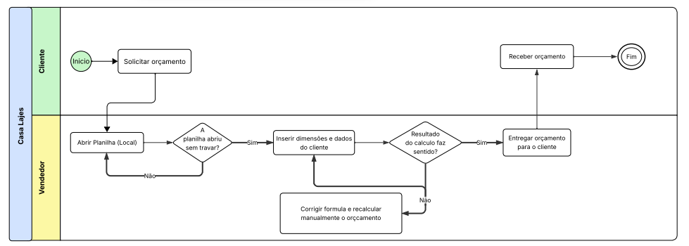

### Processo 1 AS-IS – Geração de Orçamento de Lajes Pré-Moldadas

#### Descrição do Processo

O processo de geração de orçamento de lajes pré-moldadas é iniciado quando um cliente solicita um orçamento ao vendedor da Casa Lajes. O vendedor localiza a planilha Excel salva em seu computador local, insere manualmente as dimensões das lajes e os dados do cliente, aguarda o cálculo das fórmulas e entrega o resultado verbalmente ou de forma impressa. O processo é suscetível a travamentos da planilha, erros de fórmula, divergências entre versões e ausência de padronização na entrega. Não há registro automático do orçamento gerado.

**Fluxo resumido:**
Cliente solicita → Vendedor abre planilha local → Insere dimensões manualmente → Planilha calcula (com risco de erro) → Vendedor verifica resultado → Entrega orçamento verbal/impresso → Arquivo salvo localmente (ou perdido)

---

---

#### Detalhamento das Atividades

**Receber pedido do cliente**

| **Campo** | **Tipo** | **Restrições** | **Valor default** |
| --- | --- | --- | --- |
| Nome do cliente | Caixa de Texto | Obrigatório | — |
| Telefone de contato | Caixa de Texto | Formato (XX) XXXXX-XXXX | — |
| Tipo de obra | Seleção única | Residencial / Comercial / Industrial | Residencial |
| Observações do pedido | Área de texto | Máximo 500 caracteres | — |
| Data do pedido | Data | dd-mm-aaaa | Data atual |

| **Comandos** | **Destino** | **Tipo** |
| --- | --- | --- |
| Confirmar pedido | Localizar planilha no computador | default |
| Cancelar | Fim do Processo | cancel |

---

**Localizar planilha no computador**

| **Campo** | **Tipo** | **Restrições** | **Valor default** |
| --- | --- | --- | --- |
| Nome do arquivo localizado | Caixa de Texto | Obrigatório | — |
| Computador utilizado | Seleção única | PC 1 / PC 2 / PC 3 / Notebook | — |
| Data de modificação do arquivo | Data | dd-mm-aaaa | — |
| Planilha abre sem erro? | Seleção única | Sim / Não (trava ou erro) | — |

| **Comandos** | **Destino** | **Tipo** |
| --- | --- | --- |
| Planilha abriu corretamente | Inserir dimensões das lajes | default |
| Planilha não abre / trava | Localizar planilha no computador (retrabalho) | cancel |

---

**Inserir dimensões das lajes manualmente**

| **Campo** | **Tipo** | **Restrições** | **Valor default** |
| --- | --- | --- | --- |
| Quantidade de lajes | Número | Inteiro positivo, mínimo 1 | — |
| Comprimento da laje (m) | Número | Decimal, maior que 0 | — |
| Largura da laje (m) | Número | Decimal, maior que 0 | — |
| Tipo de laje | Seleção única | Laje 08 / Laje 10 / Laje 12 / Laje 15 / Laje 20 | — |
| Reforço necessário? | Seleção única | Sim / Não | Não |
| Observações técnicas | Área de texto | Máximo 300 caracteres | — |

| **Comandos** | **Destino** | **Tipo** |
| --- | --- | --- |
| Confirmar e calcular | Verificar resultado da planilha | default |
| Limpar campos | Inserir dimensões das lajes manualmente | cancel |

---

**Verificar resultado da planilha**

| **Campo** | **Tipo** | **Restrições** | **Valor default** |
| --- | --- | --- | --- |
| Quantitativo de vigotas | Número | Gerado pela planilha | — |
| Quantitativo de lajotas | Número | Gerado pela planilha | — |
| Quantitativo de cimento (sc) | Número | Gerado pela planilha | — |
| Quantitativo de aço (kg) | Número | Gerado pela planilha | — |
| Valor total estimado (R$) | Número | Gerado pela planilha | — |
| Fórmulas apresentaram erro? | Seleção única | Sim / Não | — |
| Resultado parece correto? | Seleção única | Sim / Não | — |

| **Comandos** | **Destino** | **Tipo** |
| --- | --- | --- |
| Resultado correto — prosseguir | Entregar orçamento ao cliente | default |
| Resultado com erro — corrigir | Inserir dimensões das lajes manualmente (retrabalho) | cancel |

---

**Entregar orçamento ao cliente**

| **Campo** | **Tipo** | **Restrições** | **Valor default** |
| --- | --- | --- | --- |
| Forma de entrega | Seleção única | Verbal / Impresso / WhatsApp | — |
| Valor total informado (R$) | Número | Obrigatório | — |
| Data da entrega | Data | dd-mm-aaaa | Data atual |
| Hora da entrega | Hora | hh:mm:ss | — |
| Cliente aceitou o orçamento? | Seleção única | Sim / Não / Pendente | Pendente |
| Observações da entrega | Área de texto | Máximo 300 caracteres | — |

| **Comandos** | **Destino** | **Tipo** |
| --- | --- | --- |
| Registrar entrega | Salvar arquivo no computador | default |
| Cliente recusou | Fim do Processo | cancel |

---

**Salvar arquivo no computador**

| **Campo** | **Tipo** | **Restrições** | **Valor default** |
| --- | --- | --- | --- |
| Nome do arquivo salvo | Caixa de Texto | Obrigatório | orçamento_[data] |
| Local de salvamento | Caixa de Texto | Caminho da pasta no PC | — |
| Computador onde foi salvo | Seleção única | PC 1 / PC 2 / PC 3 / Notebook | — |
| Arquivo salvo com sucesso? | Seleção única | Sim / Não (perdido) | — |
| Data do salvamento | Data e Hora | dd-mm-aaaa, hh:mm:ss | Data e hora atual |

| **Comandos** | **Destino** | **Tipo** |
| --- | --- | --- |
| Arquivo salvo | Fim do Processo | default |
| Arquivo não salvo / perdido | Fim do Processo (sem registro) | cancel |
