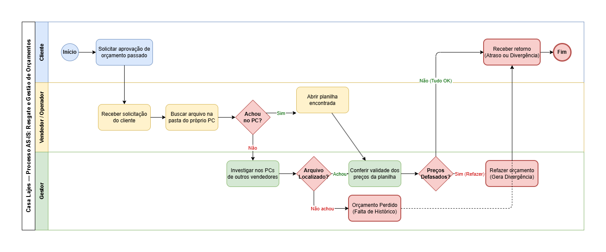

### Processo 2 AS-IS – Resgate e Gestão de Orçamentos

#### Descrição do Processo

O processo de controle e gestão de orçamentos é de responsabilidade do gestor da Casa Lajes. Após cada atendimento, o vendedor salva — quando lembra — o arquivo da planilha em seu próprio computador. Não existe um repositório centralizado ou banco de dados compartilhado. Quando o gestor precisa consultar um orçamento anterior, analisar o histórico de atendimentos ou atualizar preços e parâmetros, precisa buscar manualmente os arquivos dispersos entre os diferentes computadores da empresa. A atualização de preços exige intervenção individual em cada máquina, o que raramente ocorre de forma sincronizada, perpetuando o problema das versões divergentes. O cliente, por sua vez, frequentemente recebe informações imprecisas ou atrasadas em decorrência dessas falhas.

**Fluxo resumido:**
Vendedor salva arquivo localmente (ou perde) → Gestor recebe demanda de consulta → Busca arquivo em PCs → Verifica se versão está atualizada → Consolida dados manualmente → Atualiza planilha em cada PC separado → Cliente recebe resposta imprecisa ou atrasada

---

---

#### Detalhamento das Atividades

**Salvar arquivo no computador local**

| **Campo** | **Tipo** | **Restrições** | **Valor default** |
| --- | --- | --- | --- |
| Nome do arquivo | Caixa de Texto | Obrigatório | orçamento_[data] |
| Computador onde foi salvo | Seleção única | PC 1 / PC 2 / PC 3 / Notebook | — |
| Local de salvamento | Caixa de Texto | Caminho da pasta no PC | — |
| Arquivo salvo com sucesso? | Seleção única | Sim / Não (perdido) | — |
| Data e hora do salvamento | Data e Hora | dd-mm-aaaa, hh:mm:ss | Data e hora atual |

| **Comandos** | **Destino** | **Tipo** |
| --- | --- | --- |
| Arquivo salvo | Receber demanda de consulta | default |
| Arquivo não salvo | Fim do Processo (sem registro) | cancel |

---

**Receber demanda de consulta ou relatório**

| **Campo** | **Tipo** | **Restrições** | **Valor default** |
| --- | --- | --- | --- |
| Tipo de demanda | Seleção única | Consulta de orçamento / Relatório de produção / Atualização de preços | — |
| Data do orçamento buscado | Data | dd-mm-aaaa | — |
| Nome do cliente relacionado | Caixa de Texto | Opcional | — |
| Solicitante da consulta | Caixa de Texto | Obrigatório | — |
| Data da solicitação | Data e Hora | dd-mm-aaaa, hh:mm:ss | Data e hora atual |

| **Comandos** | **Destino** | **Tipo** |
| --- | --- | --- |
| Iniciar busca | Identificar qual PC pode ter o arquivo | default |
| Cancelar | Fim do Processo | cancel |

---

**Identificar qual PC pode ter o arquivo**

| **Campo** | **Tipo** | **Restrições** | **Valor default** |
| --- | --- | --- | --- |
| Computador suspeito | Seleção única | PC 1 / PC 2 / PC 3 / Notebook | — |
| Vendedor responsável pelo atendimento | Caixa de Texto | Opcional | — |
| Arquivo encontrado? | Seleção única | Sim / Não | — |
| Observações da busca | Área de texto | Máximo 300 caracteres | — |

| **Comandos** | **Destino** | **Tipo** |
| --- | --- | --- |
| Arquivo encontrado | Abrir e verificar planilha encontrada | default |
| Arquivo não encontrado | Fim do Processo (histórico perdido) | cancel |

---

**Abrir e verificar planilha encontrada**

| **Campo** | **Tipo** | **Restrições** | **Valor default** |
| --- | --- | --- | --- |
| Nome do arquivo aberto | Caixa de Texto | Obrigatório | — |
| Data de modificação do arquivo | Data | dd-mm-aaaa | — |
| Versão compatível com a atual? | Seleção única | Sim / Não (desatualizada) | — |
| Dados batem com o esperado? | Seleção única | Sim / Não (divergência) | — |
| Observações da verificação | Área de texto | Máximo 300 caracteres | — |

| **Comandos** | **Destino** | **Tipo** |
| --- | --- | --- |
| Versão correta — usar dado | Consolidar dados manualmente | default |
| Versão desatualizada | Consolidar dados manualmente (com ressalva) | cancel |

---

**Consolidar dados manualmente**

| **Campo** | **Tipo** | **Restrições** | **Valor default** |
| --- | --- | --- | --- |
| Orçamentos localizados | Número | Inteiro positivo | — |
| Orçamentos não localizados | Número | Inteiro positivo | — |
| Período analisado | Data | dd-mm-aaaa | — |
| Dados consolidados | Área de texto | Obrigatório | — |
| Relatório gerado? | Seleção única | Sim / Não | Não |
| Arquivo do relatório | Arquivo | Formatos: .xlsx, .pdf | — |

| **Comandos** | **Destino** | **Tipo** |
| --- | --- | --- |
| Consolidação concluída | Atualizar planilha em cada PC | default |
| Dados insuficientes | Fim do Processo (relatório incompleto) | cancel |

---

**Atualizar planilha em cada PC separado**

| **Campo** | **Tipo** | **Restrições** | **Valor default** |
| --- | --- | --- | --- |
| Computador atualizado | Seleção múltipla | PC 1 / PC 2 / PC 3 / Notebook | — |
| Tipo de atualização | Seleção múltipla | Preços / Parâmetros de cálculo / Tabela de materiais | — |
| Data da atualização | Data e Hora | dd-mm-aaaa, hh:mm:ss | Data e hora atual |
| Todos os PCs foram atualizados? | Seleção única | Sim / Não (parcial) | Não |
| Observações | Área de texto | Máximo 300 caracteres | — |

| **Comandos** | **Destino** | **Tipo** |
| --- | --- | --- |
| Atualização concluída em todos | Fim do Processo | default |
| Atualização parcial | Fim do Processo (risco de divergência) | cancel |
